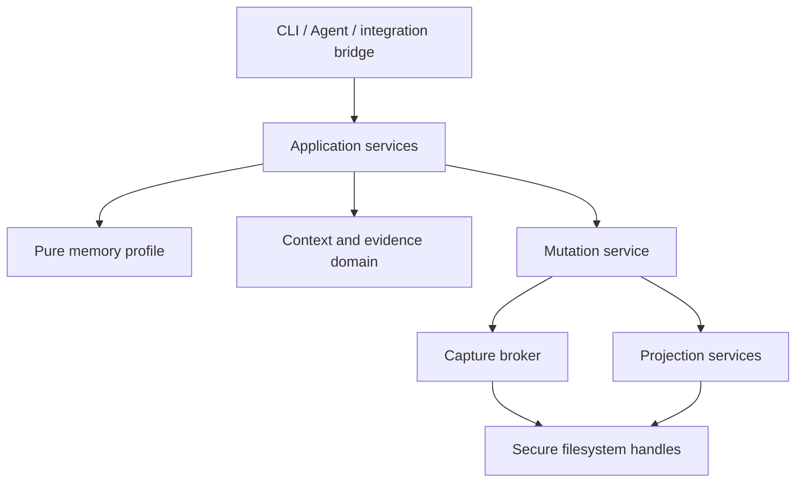

# KnowledgeRouter architecture

Current architecture: 0.2, 2026-10-23. [ADR-001](docs/decisions/001-unified-memory-workflows.zh.md)
records the decisions, rejected alternatives and acceptance criteria. The development queue is
[docs/development-plan.zh.md](docs/development-plan.zh.md).

## 1. Ownership and product boundary

2026-10-25 boundary decision: prioritize [data-layer contracts and governance](docs/data-layer-contract.zh.md).
The core exposes identified, locatable source records, explicit metadata/relations, integrity signals and recoverable authorized writes. Research synthesis, semantic conflict resolution and business decisions belong to callers. Contexts are optional saved source selections; knowledge pages and domain workflows remain compatible optional applications, not prerequisites or core acceptance gates. No registered Context or source is changed by this decision.

Original Markdown is human-owned. Durable external control records hold definitions, frozen plans,
idempotent command intents and mutation/event receipts. Both require backup. Indexes, taxonomy and
relationship graphs are disposable projections. A generic Context kernel supports existing layouts;
the annual-stream/contact profile is an optional application, not a new storage engine.

## 2. Dependency direction

| Boundary | Modules | Responsibility |
|---|---|---|
| Interfaces | `knowledge_router.py`, `memory_commands.py`, `bootstrap.py`, Ductor bridge | Arguments, rendering, exit codes; no direct source mutation |
| Memory application | `memory_service.py` | Registered intents, workflow previews, bounded operations, explicit buffer import |
| Memory profile | `triage_engine.py`, `text_document.py` | Verified identity, classification, lossless framing and proposals; no source mutation |
| Shared commit application | `mutation_service.py` | Commit, optional domain receipt callback, index refresh, honest pending-index result |
| Mutation kernel | `capture_broker.py`, `secure_io.py` | Policy, frozen byte plan, CAS, exclusive handles, reconciliation |
| Read application | `vault_service.py` | Attach, immutable generations, status, source-backed search |
| Context domain | `context_manager/store/events/state/followups/maintenance/tick.py` | Scope, revision, one event with multiple links, explicit/conflicting state, opt-in review |
| Knowledge and governance | `context_brief/compile/review.py`, `knowledge_page.py`, `link_*.py`, `maintenance_cycle.py` | Evidence bundles, derived artifacts, source drift and review receipts |
| Evidence adapters | `fts_indexer.py`, `project_adapter.py`, `evidence.py`, `quality_analyzer.py` | Vault/Git projections, canonical evidence and explainable findings |
| Provisioning and recovery | `scaffold.py`, `runtime_backup.py` | Explicit initialization; allowlisted backup and isolated restore |

The shared commit service is used by generic capture, memory workflows and Context event execution.
Context applied receipts are published before indexing via the service callback, so failure remains
resumable. Profile modules cannot import the mutation application or broker. Existing file layout
and source/installed entrypoints are retained; a package directory migration is not a prerequisite.

## 3. Read and publication flow

Attach/sync takes a verified scan, induces taxonomy, builds a content-addressed SQLite generation,
then re-scans before activation. Search verifies binding and re-reads returned sources to disclose
staleness. FTS5, CJK bigrams and rule aliases are the implemented retrieval strategy.

Context definitions are versioned external records. Inferred candidates are not write authority.
State declarations retain conflicts and replacement history. Compiled cards and knowledge pages live
outside the Vault by default and retain source dependencies. Sourced claims and labelled inference
remain distinct; tools validate evidence, while a caller authors prose.

`brief --budget-tokens` uses the shared disclosed estimator and bounds its complete serialized result.
Scoped Context briefs still scan live sources; cross-command shared snapshots and incremental reads
remain roadmap work. A published knowledge page is not automatically revised by new evidence.

## 4. Mutation flow and capabilities

| Policy | Exclusive create | Prefix-preserving append | Full document edit |
|---|---|---|---|
| `off` | No | No | No |
| `append-create` | Yes | Yes | No |
| `reviewed-edit` | Yes | Yes | Yes |

All commands freeze the exact destination and byte payload. Preview is the default for generic
capture and historical triage; explicit append verbs commit, with an optional `--preview` flag.
The broker rechecks current registration/policy, validates the persisted plan, records PREPARED,
pins directories, checks source SHA-256/length and applies through one verified file handle.
COMMITTED is recorded before the application refreshes the index. A failure after application is
`applied_pending_index`, exit 2, with a plan id; replay never repeats the source write.

Schema 3 introduces `replace_existing` with a complete original-byte backup in the frozen plan.
It requires reviewed-edit and Windows exclusion of readers and writers. It is an in-place checked
edit, not a crash-atomic replacement. Exact before/after states reconcile; partial/unknown content
requires manual reconciliation using the retained original. Schema 2 plans retain their old hash
shape, supported actions and replay behavior. No source delete, rename or move primitive is added.

## 5. Optional memory profile

Annual entries and contact logs append at EOF. A repeated month/Log heading is used when the old
section is not last; old bytes are never reformatted. Only a new todo is classified during capture.
Historical triage creates an edit proposal and requires reviewed-edit for application.

Contact identity is the Vault-relative path. Unique names stay convenient selectors; aliases map to
candidate sets and ambiguity is preserved. Templates and linked sources are excluded. Contact
metadata and related source reads share a verified scan, using the common alias parser.

An external `workflow.<hash>.json` binds an intent key and request digest to one broker plan before
commit. Retrying the same intent reuses its timestamp, target, byte basis and response metadata;
a different request using the same key fails. These records are durable and included in backups.

`inbox drain` imports old buffer entry occurrences using stable intent keys and leaves the source
buffer intact. It is explicit, restartable and never calls itself through triage. Completed task
markers are preserved. Legacy daily relocation commits are retired; their analyzer remains read-only.

## 6. Provisioning, interfaces and remaining scope

Scaffold is the sole explicit profile provisioning boundary: it may create directories, rejects
links/reparse points, pins the root chain and uses exclusive file creation. Existing ordinary files
are skipped. Runtime mutations cannot create a directory tree. Scaffold defaults to policy off.

Exit codes: 0 success, 1 findings or missing read selection, 2 operational/safety failure including
pending indexing. Python minimum is 3.11. No runtime third-party dependency, daemon, vector service,
remote notification or automatic production activation is introduced. Windows writer-exclusion
requirements are not weakened on other platforms.

The real knowledge-update loop, claim-impact analysis, cross-command incremental snapshots and
learning from work remain explicit future milestones, separate from this architecture convergence.

## 2026-10-25: personal profile convergence

Approved product scope: idea/memo/todo are raw capture streams; Biography is an evidence-reviewed achievement domain; Investment owns accounting. Shared entrypoints do not erase domain rules. Reuse memory_service._execute, capture_broker and mutation_service rather than add another writer/registry/database. streams append/list/check are optional personal-profile adapters; absent directories fail. Records carry block IDs; frozen workflow intents preserve retries and source CAS. No auto-promotion, transaction posting or reminders.

Preserve installed todo_time semantics: creation time is not a Tasks scheduled date; ambiguous dates remain unresolved. Area occurrence dates use --date; year headings follow the occurrence. personal_review consumes the shared scan and joins maintained Context review agendas. Structural checks do not certify evidence or reconcile portfolios.

Local deployment: one repository code source, installed stable CLI launcher via a machine-local source descriptor; the shell imports the repository's thin integration. Keep existing state/policy unchanged. The user-approved one-time Biography maintenance has a recovery archive and does not broaden runtime write policy.

## 2026-10-25: measured Context read optimization

Exact registered Context IDs use their reviewed definition without rediscovering every Context. scan_notes accepts explicit relative scopes; it still enumerates paths live but only validates/reads selected content, with existing pinned-source reads. Linked event sources outside scope remain included. Names/inferred IDs keep global discovery to preserve ambiguity behavior. Each source's tags are parsed once per discovery snapshot.

No content cache, metadata-only freshness shortcut, background watcher or index policy change is introduced. Evidence is re-read and hashed before return. Scoped source_generation is explicitly labelled source_generation_scope=context_scopes_and_linked_events; name/inferred discovery retains vault. This digest is not a full Vault/index generation. Full index activation still requires the two complete scans.

## 2026-10-25: verified incremental index generation

Source membership and bytes remain authoritative: two complete live scans still gate publication. No source note is skipped because mtime/size looks unchanged. A candidate can clone the explicitly registered active SQLite index with SQLite backup; a valid base must match Vault/schema/manifest, source-payload checksums, FTS content/integrity and CJK postings/statistics. Only added/changed/deleted notes and their derived postings are rewritten; metadata-only changes avoid token rebuilds. Missing/incompatible/corrupt bases fall back to the existing full builder with a disclosed reason.

Candidates remain temporary until the second complete scan confirms the source generation. Pointer publication and pruning share the same per-Vault index lock as construction. Failure preserves the prior pointer; a completed but unpublished candidate may be reused on retry. An unchanged-generation cache is checked for semantic projection corruption, not just SQLite page integrity. No schema migration, new database service, file watcher or write-policy change.
