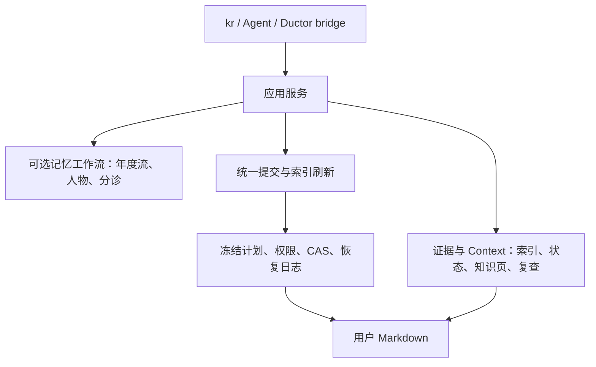

# KnowledgeRouter (`kr`)

面向本地 Markdown / Obsidian Vault 的证据与 Context 维护工具。保留原有目录，
为 Agent 提供带出处的检索、显式状态、知识页和可恢复的受控记录。

**0.2.0 · Python 3.11+ · 无运行时第三方依赖 · Windows 写入内核。**
读取不要求 Obsidian 或 Ductor 运行。追加、全文编辑依赖 Windows 排他句柄；其他平台拒绝这些操作。

## 架构



- **来源**：用户 Markdown 是原始内容；Context 定义、冻结计划、回执与变更日志是外部持久控制记录。
  两者都需要备份；FTS 索引与关系图是可重建投影。
- **检索**：SQLite FTS5、中文二元词、规则别名扩展；每条证据带路径、行号、SHA-256 和过期标识。
- **Context**：有用途、范围和生命周期的上下文，支持一个事件关联多处、显式状态、冲突和跟进。
- **知识维护**：版本化知识页、来源依赖、预算读取、主张展开和复查议程。正文由人或 Agent 编写，工具核验依据。
- **六切片工作流**：Focus、Idea、Memo、Todo、Contact、Ownly 目录模板，是可选工作流。
  Ownly 当前通过 Markdown 索引与目录兼容接入；不包含专用财务计算或自动日历同步。

设计与迁移依据：[DESIGN.md](DESIGN.md)、[ADR-001](docs/decisions/001-unified-memory-workflows.zh.md)、
[当前开发计划](docs/development-plan.zh.md)。

## 安装与接入

```bash
pip install -e .
kr --help
# 源码方式也可直接使用，无需安装
python scripts/knowledge_router.py --help

# 接入已有 Vault；默认只读，不改原文
kr attach "/path/to/vault" --name personal
kr search "项目主题" --vault personal --json
kr brief "项目主题" --vault personal --budget-tokens 1500 --json
```

`--budget-tokens` 是明确披露的字符估算，不是真实模型分词器。`brief` 预算包含完整 JSON
（引用、元数据和 Markdown），放不下的来源会省略并计数，无法容纳元数据时明确报错。

## 可选六切片工作流

```bash
# 显式初始化模板；已有文件跳过、链接路径拒绝；默认写入策略为 off
kr scaffold "/path/to/vault" --name personal

# 显式启用追加/创建，再进行记录
kr attach "/path/to/vault" --name personal --write-policy append-create
kr inbox append idea "一个值得保留的想法" --vault personal
kr inbox append memo "接口已确认" --vault personal --idempotency-key meeting-001
kr inbox append todo "讨论模型评估" --vault personal
kr contact append "联系人姓名或别名" "已确认下一次沟通安排" --vault personal
kr contact show "联系人姓名" --vault personal
```

模板目录：`000_Inbox/{FOCUS,idea.YYYY,memo.YYYY,todo.YYYY}.md`、`100_Project/`、
`200_Area/Biography/`、`300_Resources/305_Contact/`、`WYQD/`、`400_Archives/`。
运行时命令要求目标父目录已存在；使用 scaffold 显式初始化。

记录严格保留已有文件的字节前缀、BOM 和换行。若目标月份或 Log 已不是末节，在文件末尾
追加同名章节。只分诊新捕获的待办，不顺带改写历史任务。联系人同名或别名冲突时拒绝写入，
可传入精确的 Vault 相对路径（包括 `.md`）消歧。

`inbox append` 和 `contact append` 是明确的提交操作；增加 `--preview` 可只生成冻结计划。
成功返回时索引已刷新；若内容已写入但索引失败，返回 `applied_pending_index`、plan id 和退出码 2。
重试原计划或同一 `--idempotency-key`，不会重复写入；不同请求不能复用同一键。

## 全文分诊与旧缓冲导入

```bash
# 先预览历史任务的拟议改动
kr triage todo --vault personal --json

# 全文编辑采用独立策略；append-create 不授权这种修改
kr attach "/path/to/vault" --name personal --write-policy reviewed-edit
# 将预览返回的 plan id 代入；提交时重新核对原文
kr capture --plan-id PLAN_ID --commit --vault personal --json

# 显式导入旧 Quick_Capture.md，原缓冲保留；重复执行按持久记录去重
kr inbox drain --vault personal --json
```

全文编辑计划包含完整 before/after，持有排他句柄校验并写入。它不提供跨崩溃的原子可见性：
部分写入会标记 `NEEDS_RECONCILIATION`，保留计划中的原文供核对恢复，拒绝盲目重试。
详见[安全契约](references/safety_contract.md)。
旧 `migrate_daily_logs.py` 仅保留只读分析，自动重写和搬移原始日记的入口已停用。

## Context 与知识页

```bash
kr contexts discover --vault personal --json
kr contexts register --definitions examples/contexts.json --vault personal --json
kr contexts brief CONTEXT_ID --query "当前有哪些证据？" --vault personal --json
kr contexts compile CONTEXT_ID --vault personal --json
kr contexts page publish CONTEXT_ID --content-file draft.md --vault personal
kr contexts get CONTEXT_ID --budget-tokens 1200 --vault personal --json
kr contexts review --vault personal --no-record --json
```

Context 定义和草稿格式分别见 [Context 协议](references/context_protocol.md)与
[知识页协议](references/knowledge_pages.md)。`contexts get` 的预算目前核算主张文本，
并披露省略数；完整输出预算由通用 `brief` 提供。维护策略、调度和远端通知必须显式接入，
命令可用不代表生产流程已启用。

## 外部状态与 Agent 接入

状态默认存于 `~/.knowledge-router/vaults`，可用 `KNOWLEDGE_ROUTER_STATE_ROOT` 覆盖；
主目录未建立且旧 Ductor 注册表存在时兼容 `~/.ductor/vaults`。状态与来源必须位于不同目录。

Agent 按 [SKILL.md](SKILL.md) 调用 CLI。可选 Ductor 桥接位于 `integrations/ductor/knowledge_router.py`；
它只转发明确参数，不证明宿主已经加载检索钩子或启用了调度。

## 从 0.1 迁移

- 无须搬移笔记或重建 Context。旧 schema 2 冻结计划仍可读取、提交与幂等重放。
- Python 最低版本调整为 3.11；scaffold 默认保持 `off`。
- `append-create` 的权限不扩大；历史任务全文修改显式使用 `reviewed-edit`。
- 内部 Python 写入助手迁入 `memory_service`，调用必须提供 `VaultRegistry` 与 `VaultConfig`。
  稳定公开接口为 CLI 和包的 `main` / `__version__`；内部模块不作为独立 Python SDK 发布。
  `triage_engine` 仅承担分析与查询，不再提供未登记 Vault 的直接写入助手。
- 备份需包含 `workflow.*.json`、冻结计划和变更日志；这些不是可丢弃缓存。

## 开发验证

```bash
python -m pip install -e . pytest ruff
python -m ruff check scripts tests integrations
python -m pytest
```

CI 覆盖 Windows Python 3.11 / 3.12 / 3.13。实测结果及适用范围记录在 [EVALUATE.md](EVALUATE.md)。

[MIT License](LICENSE)
