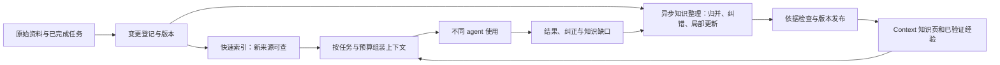

# 从 Knowledge Router 到持续演化的 Context Base

调研日期：2026-09-22。现有项目基线沿用本日源码复核 `7d063f1` 与运行验证；本轮补充官方项目、文档和论文研究，没有部署竞品或修改运行配置。

## 1. 对上一轮判断的修正

上一轮主要选择检索工具、Obsidian 插件与知识问答产品，能够回答“如何搜得更好”，不足以回答本项目的核心问题：“如何让知识随资料、工作和反馈持续演化，并成为不同 agent 可直接使用的上下文底座”。

建议把目标明确为：**由用户持有、以来源为依据、可持续修订，能够按任务向多个 agent 提供上下文的知识系统。** Router 保留为入口；产品能力需要扩展到知识编译、上下文组装与反馈学习。

在这个目标下，S1/S2 是可靠运行的基础。“编译闭环”应从长期暂缓项提升为下一阶段的核心试点；不必一次实现完整 Layer 4/5，但需要尽早证明一个 Context 能持续变好。

## 2. 选哪些项目对照

以下热度取自调研时 GitHub 官方仓库显示的约数；GitHub API 遇到限流，因此没有精确计数和统一提交时间快照。网页存在缓存差异，例如 OpenViking 显示约 38.3–38.4k。这些数字说明累计关注度，不代表近期增长率、稳定性或性能排名。

竞品能力来自其官方资料；这里没有进行逐仓源码审计和同机复测。架构适配判断是本报告的分析，不是竞品自我评价的转述。

| 项目及当前关注度 | 对照价值 | 对我们的直接启发 | 不能直接推出的结论 |
|---|---|---|---|
| [OpenViking](https://github.com/volcengine/OpenViking)，约 38k | 最贴近“Context Database”的产品类别，统一资源、记忆、技能 | 统一寻址、目录导航、按层加载、会话接入 | 不能据此认定它最适合现有 Vault，或迁移后一定更快 |
| [EverOS](https://github.com/EverMind-AI/EverOS)，约 13.1k；原 EverMemOS 地址现重定向到此 | 与本地个人知识库定位非常接近；当前 README 描述 Markdown、SQLite、LanceDB，以及知识 Wiki、用户/agent 两类记忆和离线整理 | 把来源知识、工作经验、技能放进统一生命周期 | 旧 EverMemOS 论文的成绩不能直接归给当前 EverOS 实现 |
| [Hindsight](https://github.com/vectorize-io/hindsight)，约 24.7k | 事实、经历、综合观察和长期知识页之间有明确分工；提供 retain/recall/reflect | 持久保存经过整理的认识，并在证据变化后更新 | 官方记忆 benchmark 不等于我们的研究任务、写入正确性和 Windows 部署表现 |
| [Letta Code](https://github.com/letta-ai/letta-code)，约 3.4k；此处不是 Letta 主仓星数 | MemFS / Context Repositories 把记忆放进可编辑、可版本化的文件工作流 | agent 用熟悉的文件工具维护上下文；版本历史成为产品能力 | 学习其记忆设计不意味着要替换 Ductor 或绑定 Letta harness |
| [memU](https://github.com/NevaMind-AI/memU)，约 14.4k | 当前实现强调跨 agent 的个人 Wiki，以及 prepare → agent → commit 的学习流程 | 让现有 agent 做理解和修改，存储服务负责提交、索引和检索 | 不能把支持某个宿主等同于该宿主的所有模式都已可靠支持 |
| [Acontext](https://github.com/memodb-io/Acontext)，约 3.7k | 以任务完成/失败为学习触发，将经验保存为可读 skill 文件，按需展开 | 把任务结果变成可复用的方法，减少复杂工具选择 | 不宜照搬“所有记忆都是 skill”；事实、偏好、决策和操作规则仍需区分 |
| [MemOS](https://github.com/MemTensor/MemOS)，约 11.5k | 记忆管理、反馈修正、多知识库组合及本地插件；官方新闻含 2026-08-17 更新 | 把纠错、作用域和异步处理作为核心能力 | 本地插件与服务端部署结构不同，不能混用其性能和依赖结论 |
| [Hermes Agent](https://github.com/NousResearch/hermes-agent)，约 248k | 热门 agent harness，强调从工作经验创建和改进技能 | 学习怎样把记忆嵌进日常任务完成过程 | 它不是同层的知识库；总体星数不能说明其知识层优于其他项目 |

另外两个有明确用途的参照：

- [Graphiti](https://github.com/getzep/graphiti)，约 31.1k：学习动态事实的有效时间、历史保留和增量关系管理，不必先引入独立图数据库。
- [ACE 官方实现](https://github.com/ace-agent/ace)，约 1.3k：学习从执行反馈提炼经验并增量修订 playbook 的方法。这是研究实现，不是可直接替换现有系统的完整知识库。

**优先深入顺序：OpenViking / EverOS 看产品结构，Hindsight 看知识更新，Letta / memU 看 agent 使用方式，Acontext / ACE 看学习闭环。** Hermes 用来检验体验是否自然，MemOS 用来对照反馈与记忆管理。

## 3. 最新实践带来的六个设计判断

### 3.1 已整理的知识必须是长期资产

Karpathy 在 2026-04-04 发布的 LLM Wiki 构想，把原始来源、agent 维护的 Wiki 和组织规则分开，并让摄入、查询和维护持续丰富 Wiki。它是设计模式，不是已经验证的完整产品。[LLM Wiki 原文](https://gist.github.com/karpathy/442a6bf555914893e9891c11519de94f)

我们的缺口不是再导出一张卡，而是建立卡片的持续身份：它回答什么问题、由哪些依据支撑、何时失效、哪些新资料会改变它。用户已经研究过的问题，下次应能从已有认识继续，而不是重新拼所有片段。

### 3.2 新资料应改变已有认识

Hindsight 的 observations 将相关事实归并为带依据的认识，并处理新增证据和未完成整理时的新鲜度；knowledge pages 可以随范围内知识变化增量修订。一个很值得借鉴的限制是：知识页默认不读取其他知识页，避免互相引用形成自证循环。[Observations](https://hindsight.vectorize.io/developer/observations)、[Knowledge Pages](https://hindsight.vectorize.io/developer/knowledge-pages)

对应到我们：新资料进入后，需要判断“补充、支持、冲突、替代、无影响”，而不仅是添加索引。生成页面可以互相导航，但事实性主张必须沿依据链回到独立来源；同一来源被多页重复转述，不能算多份证据。

### 3.3 agent 需要按层阅读，也需要直接检索

OpenViking 当前文档把 L0/L1 说明为目录级摘要/概览，L2 是完整内容；并不是每份文件都自动有三份副本。检索结合语义匹配和目录遍历，会话提交可触发异步记忆提取。[分层文档](https://docs.openviking.ai/en/concepts/03-context-layers)、[系统介绍](https://openviking.ai/docs)

我们应提供 Context 的简述、当前认识和原始证据三种阅读深度。不要照搬物理目录：一个资料可以属于多个研究/项目 Context。目录式导航负责“我在哪、还能读什么”，混合检索负责“这个具体问题在哪”；两者互补。

### 3.4 让已有 agent 参与维护，不必另造庞大智能服务

Letta MemFS 让 agent 用普通文件工具编辑 Git 管理的记忆，区分常驻上下文与按需阅读的内容；后台 dreaming 整理长期经验。[MemFS](https://docs.letta.com/concepts/memfs)、[Memory & dreaming](https://docs.letta.com/configuration/memory)

memU 当前流程把综合判断交给 agent，服务层处理存储、嵌入和检索。[memU 官方实现说明](https://github.com/NevaMind-AI/memU)

这很适合现有 Ductor：由现有 provider agent 生成有依据的修改提案，Knowledge Router 负责范围、版本、验证和发布。模型提供理解能力，确定性核心守住数据和状态的一致性。CLI 和后续 MCP 应共享同一服务逻辑。

### 3.5 有机增长包括纠错、合并和退出

Acontext 从任务结果中提炼经验，ACE 采用生成、反思、整理和局部增量更新；这比“每次会话追加一段摘要”更接近可积累的学习。[Acontext](https://github.com/memodb-io/Acontext)、[ACE 项目](https://ace-agent.github.io/)

我们的学习产物应区分：领域认识、用户偏好、项目决策、可复用工作方法。一次失败只提供一个观察，不能立即变成全局规则。重复记录应合并；过时方法应降级或归档；没有帮助的内容不应继续占据启动上下文。

“越用越好”的判断标准是任务成功率、纠错成本和上下文效率，而不是文件数量。

### 3.6 性能瓶颈包括新知识多久可用

2026-09-06 修订的 MemForest 论文专门研究持续读写中的记忆新鲜度，采用并行提取和局部脏路径刷新。论文明确限定：对数界适用于平衡树的结构操作/刷新深度，整体处理量仍随输入增长。它是预印本研究，不能当作已部署系统的性能保证。[MemForest v3](https://arxiv.org/abs/2605.23986v3)

对我们最有价值的启发：按变更范围更新，避免每次全库扫描或全页重写；同时测查询速度、写入成本、新证据可查询时间和知识页完成更新时间。

## 4. 我们现有能力与目标之间的距离

以下沿用本日已完成的本机复核，不冒充本轮重新执行的测试。

| 维度 | 当前已有基础 | 下一步真正缺失的能力 |
|---|---|---|
| 可信来源 | 路径/行号/哈希、EvidenceRecord、读取复验 | 主张级依据链；页面变更与源版本之间的依赖 |
| 知识组织 | Context 定义、范围、关系、状态与事件 | 可更新的综合认识，而非主要依赖显式配置和事件 |
| agent 接入 | skill、CLI、Ductor 新会话注入 | 任务级上下文包、按需展开、跨 agent 一致使用 |
| 持续维护 | review、maintenance、compile 框架 | 实际运行的一条“资料变化→受影响页更新→下次使用”链路 |
| 学习 | 受控 capture、可留存事件 | 任务结果与用户纠正转成候选经验，并验证后复用 |
| 性能 | FTS 检索；此前 hook 实测约 0.45–0.63 秒 | brief/review 等重复扫描消除，版本化读取与增量编译 |

当前更接近“有可靠边界的 Context 工具集”，尚未达到“持续演化的 Context Base”。已有写入 broker、来源校验、Context 和事件基础值得保留。

此前四项边界问题仍应收尾：范围改变时 review 基线比较、扫描不完整时 CLI 退出状态、`../` 链接解析、自定义输出卡片的过期检测。这些是后续可信更新的前置条件，但不应占据整个产品路线。

## 5. 建议的架构

### 5.1 清楚区分四类内容

| 内容 | 维护方式 | 权威性 |
|---|---|---|
| 原始资料与用户笔记 | 保持现有授权写入规则，观察版本变化 | 某来源说了什么的依据；不等于内容天然真实 |
| Context 知识页 | 在明确授权的 agent 管理区内允许修订、合并、归档，保留版本 | 有出处的综合认识，明确推断、冲突、待核实内容 |
| 任务经验与技能 | 从任务结果提案、检查、试用，再决定推广 | 有适用范围的工作方法，不作为领域事实证据 |
| 会话与工作记录 | 有期限地留存必要动作、结果、纠正和产物引用 | 学习输入，不整体塞入每次上下文 |

另外，Context 定义、权限、人工确认和变更回执属于持久控制记录。它们不能像索引一样随意删除重建。

关键修正：**保护用户原文，同时允许 agent 管理的知识层演化。** 如果所有内容只能追加，系统最终会充满重复、失效和相互矛盾的摘要。

### 5.2 一条阅读路径，一条增量维护路径

先保持模块化单体：本地 SQLite 管理来源版本、依赖、队列和投影；Markdown 提供可读知识页；现有 Python 入口继续兼容。独立向量库、图数据库和常驻服务都按实测需求引入。

实现要点：

1. 统一 `search/brief/compile/review` 的来源注册与读取快照，Context 范围及定义版本进入缓存/比较键。
2. 记录“源片段→主张/页面→概览”的构建依赖。新资料首先按实体、主题和范围寻找可能受影响的页；不能只刷新已有依赖，否则新来源永远不会影响旧页。
3. 分开导航关系和证据依赖。导航可以循环，证据必须可追溯，编译调度不能被页面互引困住。
4. 新内容先可检索；耗时综合在后台完成。处理未完成时显式显示 pending/stale，原始证据仍可读取。
5. 每次发布绑定来源快照、Context 定义版本及整理规则版本；来源已改变则重新校验。发布使用版本检查、幂等回执和可恢复日志，不能靠 Git 自动解决语义冲突。
6. 概览、正文和 manifest 以同一发布版本生效；记录真实输出路径，覆盖自定义外部卡片。
7. 使用不可变已发布版本服务查询，后台更新只影响下一版；用户纠正须标识其所纠正的主张/版本。

### 5.3 agent 入口收敛为四个动作

这是拟议接口，不是当前已有命令：

| 动作 | agent 需要表达什么 | 应返回什么 |
|---|---|---|
| `context.get` | 任务、范围、时间点、token 预算 | 当前认识、关键依据、冲突/未知、相关方法、可展开 ID、版本与覆盖范围 |
| `context.expand` | 某个 Context/证据 ID 和阅读深度 | 概览、完整页面或原始证据 |
| `context.propose` | 新资料、纠正或任务经验 | 归属、变更内容、依据、影响范围及审核状态 |
| `context.feedback` | 使用了哪些内容、任务结果、具体纠正 | 可追溯的反馈记录；后续整理状态 |

知识整理可以复用同一个提案/发布内核。不要在用户层暴露一串底层维护命令。发布策略沿用授权边界，工具接受提案并不意味着允许修改任何用户来源。

上下文预算也要覆盖常驻索引、工具说明和重复注入。不能把全库目录永久塞入提示词，然后只计算返回片段的 token。

### 5.4 需要先验证的产品对象

第一版只做两类长期对象：**研究主题页**和**项目状态页**。每个对象至少有稳定 ID、用途、范围、当前认识、依据、未决问题、版本、更新状态。以主张是否由原文明确支持来区分引用与推断，不依赖模型自行打一个“置信度分数”。

技能经验是第二步加入的对象。优先保留明确纠正、可重复的成功方法和失败条件；任务被 agent 自报“完成”不能单独作为规则可靠的证据。

## 6. 自研、接入还是替换

| 方案 | 价值 | 主要代价 | 建议 |
|---|---|---|---|
| 在现有核心上增加最小 Context 编译闭环 | 最快利用现有 Vault、证据和 broker；便于比较前后效果 | 需要承担部分知识编译维护 | 默认第一步 |
| 将 OpenViking 或 EverOS 作为可替换后端试验 | 验证成熟结构是否节省开发、提高任务表现 | 身份、来源语义、写权限、版本映射和部署适配 | 在隔离副本上用同一任务集做小规模对照，再决定 |
| 全面迁移或同时叠加多个记忆系统 | 获得更多现成功能 | 两套事实/版本、维护复杂、结果难归因 | 当前不建议 |

做后端对照时保留当前版本、极简 Markdown Wiki、OpenViking/EverOS 试验三组。复杂系统需要赢过一个简单而可靠的基线。

如考虑复用代码，应核对选定版本和组件：OpenViking 当前仓库声明主项目 AGPLv3，CLI/examples 存在不同许可；不能沿用早期介绍中的许可印象。这是接入方案需核实的事实，不是本报告对具体发行方式作出的法律判断。[官方仓库许可说明](https://github.com/volcengine/OpenViking#license)

## 7. 开发顺序与验收

以下按可独立验收的迭代排序，不虚构未估算的日历承诺。

| 阶段 | 必须交付的结果 | 验收方式 |
|---|---|---|
| P0：可信基线 | 收尾四项已复现问题；冻结来源/Context/任务测试集；统一完整性与过期表达 | 历史结论不因范围变化误报解决，部分扫描不冒充成功，所有卡片输出路径可追踪 |
| P1：一个能用的 Context Base | 在一个研究主题和一个项目上完成知识页、依据 manifest、按预算上下文包 | agent 一次调用获得可继续工作的当前认识，并能展开到来源；换会话/换 agent 仍可使用 |
| P2：一个能更新的闭环 | 新资料登记、影响分析、局部修改、冲突保留、版本发布；新问题形成带依据的知识提案 | 加入支持/冲突/替代/无关四类资料，验证该改的页改变、不该改的页稳定、失败后可恢复 |
| P3：从工作中学习 | 接收任务结果与用户纠正；形成候选方法并在后续任务验证 | 相似但未见过的任务少犯已知错误；错误经验可撤回；不把生成答案自我复制成证据 |
| P4：针对已测瓶颈优化 | 增量索引、分层预算、可选混合检索/重排；必要时进程常驻 | 同任务质量不下降时，端到端延迟、token、更新成本改善；没有收益的复杂度不保留 |

P1/P2 合起来才是下一次值得发布的能力。无需等到所有维护指标完美才验证，但正确性问题必须阻止错误发布。

### 一条具体的验收故事

以一个研究主题为例，先整理 10–20 份已有来源，形成“当前有哪些结论、各自证据是什么、还不知道什么”的页面。

随后加入一份与现有结论冲突的资料：系统定位受影响的主张，保留两种依据，更新主题页的冲突说明。用户给出适用范围上的纠正后，下一次不同 agent 获得的上下文应体现该范围，而不是再次推荐已被否定的概括。

任务完成后，只把有依据的新增分析和可验证工作方法纳入候选。重复提问不产生重复知识页。一次无关来源摄入不触发整个主题重写。

## 8. 什么才算“效果和性能更好”

首轮选 30–50 条真实任务轨迹用于试点，另留未用于调整规则的测试集；覆盖中文/英文、跨来源综合、更新、否定、时间、信息不足、用户纠正和跨 agent 继续工作。进一步比较应扩大样本并报告不确定性。

| 指标 | 定义及意义 |
|---|---|
| 任务成功率 | 用同一模型/工具预算完成真实任务；固定基线与演化版本对照，避免靠换强模型得到假收益 |
| 有依据的结论比例 | 人工或独立审查关键主张与原始来源关系；引用存在不等于推论成立 |
| 纠错保持率 | 已确认纠正能否在后续会话保留，同时没有过度推广到无关任务 |
| 更新时效 | 分别测 source searchable、knowledge consolidated、context published 三个时间点 |
| 历史与冲突正确率 | 查询“当时/现在”、撤回来源和加入相反证据后能否正确表达 |
| 使用成本 | 每个成功任务的模型 token、调用次数、检索成本、后台整理成本和人工改动量 |
| 冷/热端到端延迟 | 含启动、校验和上下文组装的 p50/p95；与索引内部查询耗时分开 |
| 知识增长质量 | 重复率、无依据新增、过期内容占比、每次变更影响页数；不奖励单纯更多文件 |
| 学习净收益 | 用过往任务更新记忆后，对未来保留任务是否改善；同时测没有记忆与冻结记忆基线 |

可以提出首轮工程目标：当前规模的热态上下文读取 p95 <1 秒、冷态 <2 秒，且不触发同步全库扫描；它们是待验证目标，不是已达成指标。后台整理时延依赖模型、输入和预算，应先测再定 SLA。

学习评估尤其要避免泄漏：测试任务的正确答案不得预先写入知识页，来源、模型、预算和配置版本必须记录。检索命中、记忆问答分数与真实任务成功率分别报告。

## 9. 值得争取的优势

“本地 Markdown、记忆、引用、跨 agent”已在多个项目中出现，不能继续作为独有卖点。

更具体的目标是：**在既有中文/双语研究知识库上，把来源变化、知识修订、任务上下文和使用反馈可靠连接起来；用户能看到为什么改变，agent 能直接接着工作。**

优势需要由可重复的案例证明：加入新论文后，相关认识在有限成本内更新；旧判断及依据仍可追踪；不同 agent 取得同一已发布版本；用户纠正能持续生效；随着使用增加，相似任务减少重复阅读和错误。

这要求优先实现小而完整的知识演化循环，而不是继续以命令数量、索引数量或诊断计数衡量进度。
