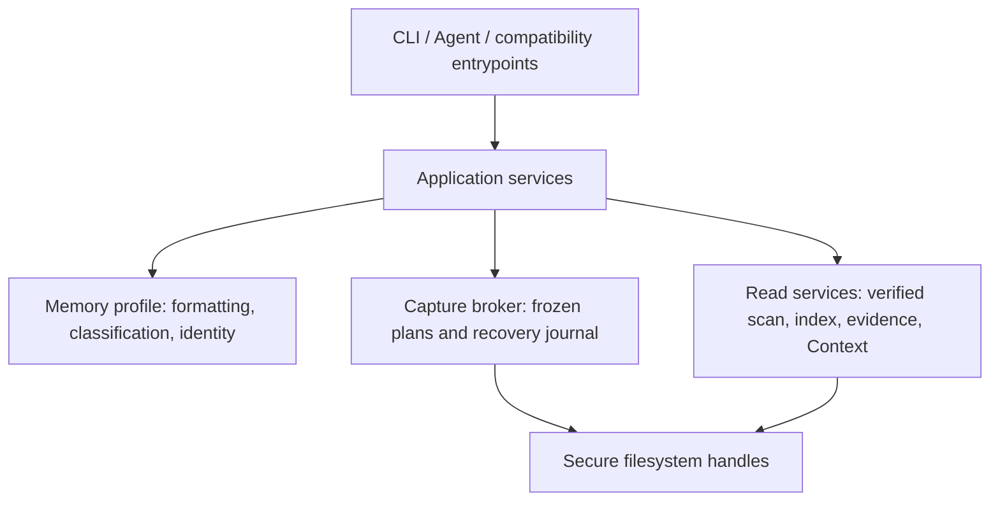

# ADR-001：统一记忆工作流与受控修改内核

状态：接受并完成实现，2026-10-23。依据：用户授权架构设计、开发状态收敛及本轮审阅缺陷修复。

## 问题

通用 Context 内核已有冻结计划、来源校验、变更日志和索引刷新。后来加入的年度流、
联系人和分诊直接全文替换文件，绕过权限与恢复机制；读后加锁不能防止丢失更新。
旧缓冲迁移递归调用自动分诊，别名冲突被静默覆盖，写后检索仍使用旧索引。

## 决策与依赖方向

1. `triage_engine.py` 提供无修改能力的分析、身份解析和格式化；`memory_service.py`
   编排已登记 Vault 的记忆工作流；`mutation_service.py` 统一提交和刷新。CLI 只适配参数/结果。
2. 默认策略为 `off`。`append-create` 仅允许逐字节保留原文前缀的追加及排他创建。
   分节插入或任务改写必须明确采用 `reviewed-edit`。该策略也允许追加/创建。
3. broker 增加 schema 3 的 `replace_existing` 计划。完整原文和修改后字节随计划持久化，
   提交时持有目录链与排他文件句柄、核对原文 SHA-256/长度、写入并验证完整结果。
   Windows 全文修改同时排除读者。中断时完整 before/after 可对账；部分写入标记
   `NEEDS_RECONCILIATION` 并保留原文，拒绝盲目重试。它不承诺跨进程崩溃的原子可见性；
   恢复依据位于外部状态，备份必须保留冻结计划和变更日志。非 Windows 修改继续拒绝。
   schema 2 的历史计划保持可读取、可重试；不扩大旧计划的权限。
4. inbox 和联系人记录采用纯追加。已有月份/Log 章节不是末节时，在末尾追加同名章节，
   保持原字节前缀，而不把插入伪装为追加。仅对新待办分诊，不顺带改写历史任务。
5. 修改命令的成功意味着提交且索引刷新成功。刷新失败返回“已写入，索引待更新”及冻结
   plan id，退出 2；重试原计划只刷新投影，不重复写入。
6. 旧缓冲通过显式 `inbox drain` 导入。按来源路径、条目原文和相同条目的出现序号构成稳定幂等键，保留已完成状态；
   缓冲原文保留，重试由日志去重。普通捕获/分诊不触发迁移。
7. 联系人以 Vault 相对路径为身份；别名映射到候选集合。只有唯一匹配可自动链接/写入；
   冲突返回候选，允许精确路径消歧。模板和链接目录/文件不作为联系人来源。
8. scaffold 是显式初始化边界，允许创建目录；排他创建文件、拒绝链接/重解析点，默认
   不开启写入策略。它不成为运行时命令自动建目录的后门。
9. Python 最低版本收敛为实际使用的 3.11。预算是明确披露的估算；通用 brief 支持预算
   并对完整机器输出核算，而非只计算被引用的正文。

## 选择理由与替代方案

- 不把全文替换继续藏在 `append-create`：这会破坏已被依赖的原文前缀保证。
- 不用“读取后加文件锁再 os.replace”：人工编辑不服从外部锁，且 Windows 释放目标句柄
  再替换存在竞争窗口。全文编辑通过已核实且排他的同一文件句柄执行，并保存恢复原文。
- 不以自动清空旧缓冲作为迁移完成：跨文件操作不是事务，清空会放大中断时的数据风险。
- 不引入新数据库、后台服务、通用事件总线或模型依赖。继续复用现有 SQLite journal 与索引。

## 本轮落地与验收

- [x] broker schema 3、显式编辑策略、完整 before/after、并发拒绝、短写对账。
- [x] 工作流无直接文件写入；只读策略覆盖所有修改入口。
- [x] 纯追加保留 BOM/换行；新内容提交后立即可检索；刷新失败可幂等恢复。
- [x] 别名/同名路径歧义拒绝；模板与链接来源拒绝。
- [x] 旧缓冲显式、非递归、可重试导入，保留完成状态和原文。
- [x] brief 预算、Python 版本、scaffold 边界、发行说明和质量检查一致。
- [x] 全套隔离测试、静态检查、源码与安装入口端到端验证。

原路线图的真实知识演化闭环、跨命令增量快照、经验学习保留为后续交付；本次不把合成
回归结果解释成真实 Vault 或 Ductor 的生产验收，不更改真实 Vault、调度器或远端服务。

最终验收：320 项隔离测试通过，ruff 与字节码检查通过；干净 wheel 在独立虚拟环境中
完成源码/安装接口的记录、检索、预算、编辑和旧缓冲重试验收。详见 [EVALUATE.md](../../EVALUATE.md)。
