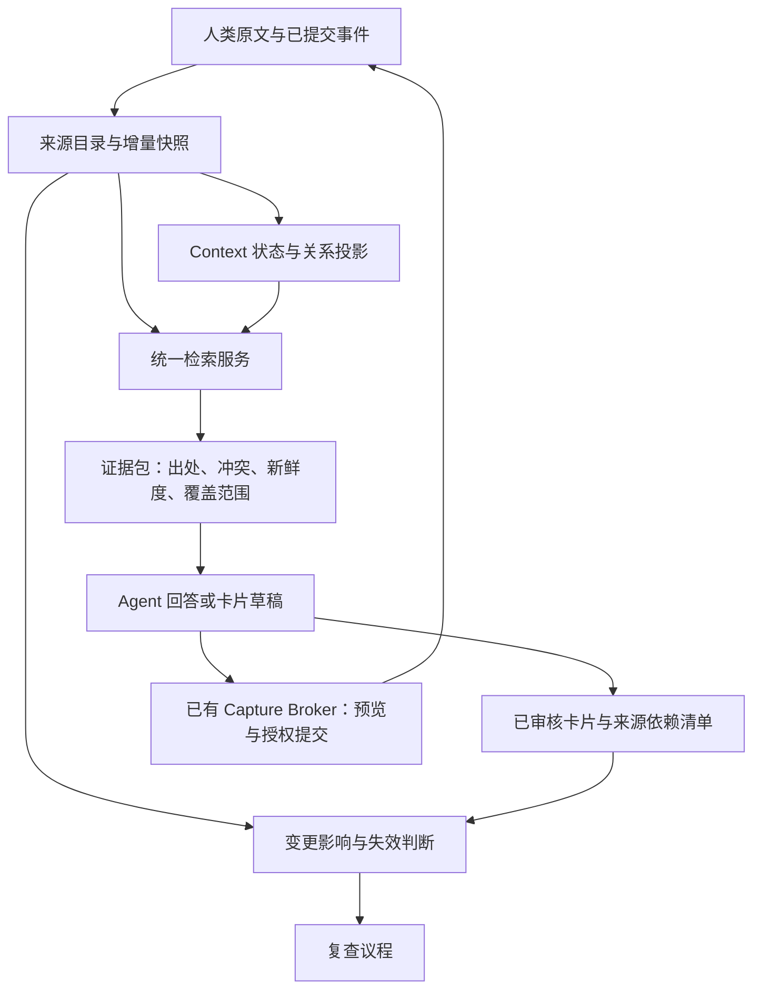

# Knowledge Router：产品构想、竞争优势与架构调整建议

日期：2026-09-22。源码基线：`7d063f1`。本文基于本机代码、前两轮复测及本轮查阅的同类产品官方资料。

比较范围是能力和设计，不是同机性能排行榜。本轮没有安装、运行其他产品，也未用同一数据集测其准确率；下文的目标值和预期收益均为设计建议，不是已取得的结果。

## 1. 总体判断

**核心基础已经实现，完整产品构想尚未实现。需要调整产品定位和若干架构边界，不需要推倒重写。**

已有基础：接入现有 Vault、可追溯检索、受控追加/创建、多 Context 事件、显式状态、关系图、外部卡片、复查台账。207 项 Router 测试和 42 项 Ductor 测试给这些机制提供了有价值的回归保障。

尚未兑现的产品承诺：自动理解已有资料中的当前状态、在连续使用中稳定找对证据、正确发现重要变化、更新已审核的知识卡、通过真实会话/维护任务完成闭环。当前安装中六个 Context 未启用维护策略，通知未配置，实际聊天自动注入仍待验收。

因此应分别评价：

| 构想层次 | 判断 |
|---|---|
| 把已有 Markdown 变成 agent 可安全使用的资料底座 | 基本实现，仍有已知正确性边界需要收尾 |
| 管理项目、人物、研究主题的状态与生命周期 | 显式定义/事件机制已实现，实际使用和旧文提取尚不足 |
| 自动维护、长期积累、有用的个人知识系统 | 尚未完成；命令齐全不等于用户工作流闭环 |
| 同类中最佳检索效果与性能 | 尚无证据支持，需公平比较和扩大评测 |

## 2. 同类产品对照

这些产品处于不同层次，不能把功能列表直接折算成一个总分，也不能因其文档没有介绍某项保障就断言其不具备。

| 对照对象 | 官方资料确认的重点 | 对 Knowledge Router 的意义 |
|---|---|---|
| QMD | 本地 BM25、向量检索、查询扩展、融合和重排；CLI、MCP、SDK，以及可常驻的 HTTP 服务 | 最直接的检索基准和潜在适配器；不要把所有检索算法都变成自己的维护负担 |
| Smart Connections | Obsidian 内本地 embedding、相关笔记发现和语义查询；通过 Obsidian 事件维护索引 | “本地、兼容现有笔记、发现联系”不是独有优势；应对标低摩擦体验和增量更新 |
| Khoj | 可自托管的个人助手，语义搜索、多种文档来源、定制 agent、自动化与通知 | 应对标真实工作流完成度，而不只比 CLI 数量 |
| AnythingLLM | 文档 RAG、agent 工具、可编排流程、MCP 和计划任务等产品能力 | 连接器、操作入口和结果查看已有成熟参照；没有必要复制一个通用聊天平台 |
| Cognee | 将文档与会话形成 agent 记忆，提供图/向量相关配置、可定制处理管线与接口 | “有图、有长期记忆”不足以构成差异；需要强调证据验证、人工确认状态和原文保护 |

资料来源：[QMD 官方仓库](https://github.com/tobi/qmd)、[Smart Connections 官方仓库](https://github.com/brianpetro/obsidian-smart-connections)、[Khoj 官方仓库](https://github.com/khoj-ai/khoj)、[AnythingLLM 文档](https://docs.anythingllm.com/)、[Cognee 文档](https://docs.cognee.ai/)。这些来源支持上述能力存在，不支持跨产品的效果优劣结论。

### 哪些优势已经具体，哪些还只是潜力

**已有且能用案例证明的优势组合：**

1. 现有笔记仍是事实来源，索引/关系图留在外部，不要求重排目录。
2. 路径、行号、来源哈希和过期标识，配合实际来源复验，便于追责和发现变化。
3. 同一事件关联多个 Context，避免把同一次交流复制到人物、项目、日记多处。
4. 已审核的精确写入预览、幂等和中断恢复；Windows 追加路径有明确的系统级竞争写保护。
5. 显式状态保留冲突和替代关系，不把最后修改时间当作事实发生时间或自动决定当前结论。

这些是本项目的具体设计价值，尚不能称为市场唯一能力。尤其本地运行、引用、图关系、MCP/agent 集成都已有同类实践。

最值得争取的定位是：

> 面向已有个人/研究知识库，提供可追溯、可恢复、能管理变化的 Context 维护层。

用一个真实任务表达差异化：

> “这个项目现在采用哪项决定？它替代了哪次旧约定？哪些原文支持它？上次状态卡为何过期？把今天的新约定预览到原有日记并关联人物与项目，重试不能重复记录。”

当这个任务每周都稳定完成，优势才从设计声明变成用户价值。

## 3. 最需要修改的产品设计

### 3.1 把功能组织为少量完整任务

保留现有细粒度 CLI 作为工具接口，用户层优先提供四类入口：

- 查证问题：找到相关且足够的新鲜证据，明确不知道什么。
- 查看 Context：当前状态、关键历史、未决冲突和下一步。
- 记录进展：一个事件、多个关联、明确预览、授权后提交。
- 复查变化：只展示值得处理的变化，说明依据，保留处置结果。

不要要求用户记住二十多个命令才能完成一次工作，也不必另造通用聊天前端。可以先依托 Ductor/现有 agent 完成自然语言操作。

### 3.2 “用途”必须成为有验证的模型

现在 Context 的用途主要来自命名规则、显式定义、目录范围和别名。它能表达用途，不等于已经理解全部资料。

建议支持由 agent 提出、用户审核的 Context 定义与状态候选；严格区分机器推断、原文明确声明和用户已确认事实。宽泛的 `project:main` 适合导航，具体项目需要稳定身份和范围才能承担状态维护。

### 3.3 保留核心轻量性，但不以零依赖限制效果上限

纯标准库、无模型的基础模式应保留。把高质量文档解析、embedding、reranker 和可替换检索引擎放入可选适配器；失败时明确降级。增加复杂依赖应由评测收益触发，而不是为了追求架构完整。

## 4. 架构中已经显露的限制

### A. 查询路径分裂

`search` 使用 FTS 索引；[context_brief.py:34](../scripts/context_brief.py:34) 每次扫描整个 Vault，再按范围筛选。

[context_brief.py:68](../scripts/context_brief.py:68) 按 10 行切窗口，`:73` 以查询词是否出现计分，随后使用锚点关系、类别、mtime 等排序。`compile` 又依赖这条路径。

影响：search 改进未必惠及用户更常用的 Context 简报；扫描、分块、评分和完整性解释重复实现。固定行窗口可能切断标题与正文、列表或结论及其限定条件。

### B. 变化处理不集中

[context_maintenance.py:36](../scripts/context_maintenance.py:36) 另行扫描 Vault；review 在调用维护轮询后又扫描来源。不同步骤可能看到不同时间的内容，而且重复支付文件读取成本。

[context_state.py:86](../scripts/context_state.py:86) 每次状态读取遍历事件回执。对多个 Context 分别重放同一批历史会随数据量增长。

### C. 派生物缺少统一依赖记录

卡片当前只写正文和少量 frontmatter。review 通过猜默认路径和比较 mtime 判断过期。自定义路径、来源删除、定义变更和审核过的文本没有一个统一生命周期。

这与已复现的自定义卡片漏检、范围变化假消解属于同一类结构问题：缺少“本结果究竟依赖什么”的持久记录。

### D. 当前评测不足以决定算法方向

真实库 22 条题包含 17 条正例和 5 条拒答，适合回归，不足以支持广泛泛化。检索实现 `_CONCEPT_ALIASES` 包含海上地震质量控制、求职简历、卫星测高等领域映射，与部分评测主题重合。这不证明刻意针对测试，但必须引入未见领域和移除词表的对照。

现有“Recall@K”主要衡量命中至少一个预期文档，引用覆盖主要检查字段。它们没有证明所有必需证据被找齐、引用真正支持答案、时间状态正确或缺失信息被识别。

## 5. 建议的目标架构

继续采用模块化的单机应用，保留 SQLite 和现有写入 broker。将查询、变化、状态投影和卡片依赖集中在共享应用服务中；CLI、Ductor 与未来 MCP 都只是调用入口。

### 5.1 一个统一的 EvidenceService

统一 `search`、`brief`、`contexts brief` 和 `compile` 的候选检索、分块及证据格式。Context 查询只是增加已审核的范围、实体身份、时间需求和状态约束，不再自行扫描和评分。

分块保留标题层级、段落、列表、原始行偏移和来源哈希。现有 `EvidenceRecord` 是可复用起点；补充来源角色、来源版本与审核/新鲜度信息。

检索分层而非每次走最贵路径：

- 明确文件、实体或事件：路径/身份定位和词法检索。
- 抽象表达或词法证据不足：可选向量检索，再融合候选。
- 多义或综合任务：对少量候选按预算重排。
- 当前状态问题：读取已确认状态和冲突，不能只让相似度决定“最新结论”。

图邻接用于扩展或导航，不自动把“链接到”提升为支持某个结论的证据。

### 5.2 增量快照与请求内复用

先实现一次操作共享 `ReadSnapshot`，以相同来源快照贯穿简报、状态、图和质量分析；这是比引入常驻服务更小且直接的优化。

随后维护文件路径、哈希、解析版本、chunk id、Context 成员关系和显式链接的来源目录。变更只重算受影响部分；文件监听只是提示，丢事件、溢出、未知变化时回退到完整核验。

**不通过省略验证来提速。** 保留不可变代际和原子切换；命中来源仍做必要的当前校验；不能把 mtime/size 当作内容完整性证明。无法证明完整时报告 unknown/incomplete。全库审计留作后台或显式操作，不阻塞每次普通问答。

### 5.3 派生卡片成为正式管理对象

每张卡片登记实际输出路径、Context 身份与定义指纹、卡片内容版本、依赖来源的完整哈希/片段位置、生成规则版本、审核状态、冲突和已知覆盖缺口。

原文变化后，只使相关卡片失效；未受影响的卡片继续复用。来源减少/移出范围要报告失效或范围变化，不能直接认定问题已解决。

已审核卡片可以辅助回答，但必须带依赖有效性检查；不能把多层摘要互引当作独立证据。原文、事件、卡片在同一目录模型中用类型和出处关联区分，不要求立刻建设两套数据库。

### 5.4 明确三类状态的权威边界

- **事实来源**：人类笔记、已提交事件及其原文。
- **必须持久保存的控制记录**：Context 定义、权限策略、批准记录、幂等/交付回执、用户审核后的卡片编辑。这些不一定能从 Markdown 重建。
- **可重建投影**：FTS/向量索引、图、状态查询缓存及派生目录。

外部化不等于可丢弃。现有备份已保留部分控制记录，文档和接口也应准确反映这一点。新增卡片登记需随之纳入恢复设计。

### 5.5 统一结果状态与比较基线

用共享结果契约分别描述执行成功、观察完整性、新鲜度和是否有事项。将范围/定义指纹、算法版本和输出截断分开。

CLI 退出码、JSON、台账比较和 Ductor 日志使用同一解释。这样可以系统性避免 `incomplete + exit 0`、换范围假消解，而不是每个模块再写一套判断。

### 5.6 常驻服务后置，但入口应可复用

当前真实只读钩子约 0.45–0.63 秒，不能把“每次起进程”直接认定为最大瓶颈。优先处理全库扫描、重复状态重放和分裂检索。

当 profiling 证明需要跨请求共享模型/索引缓存，或多个 agent 同时访问时，再增加一个可选本地服务，由现有 supervisor 管理。保留 CLI 独立可用，不引入微服务、消息集群或独立图数据库作为前置条件。

检索后端可替换：先测 QMD 的词法/混合模式和现有实现，再决定适配或自建。适配器必须补齐本项目要求的来源校验与范围边界，不能把外部检索结果直接提升为可信状态。

## 6. 怎样证明“同类最好”

目标需要限定为：在约定硬件、个人 Vault 规模、语言和更新频率下，用可接受的资源达到最好的受证据支持任务完成率。准确性、延迟、离线性、资源成本和维护成本不可能同时无条件最优。

### 公平基线

比较当前 Router、统一检索后的 Router、一个成熟检索后端（优先 QMD）以及可选语义/重排组合。支持的功能边界要一致；不把无对应功能的产品计为零分。

使用同一份隔离资料快照、相同最终回答模型与提示/上下文预算、固定线程和资源限制。分别报告首次冷启动、首次查询、热态 P50/P95、增量更新、内存占用和磁盘成本。

### 评测问题集

先做 100–200 条有标准证据的真实问题，留出一部分不用于调规则；在新的主题或第二个 Vault 上再验证。包含：

- 精确名称、别名、中英改述、缩写与跨文档综合。
- 当前决定、被替代的旧决定、冲突、来源缺失。
- 同名人物/项目、跨 Context 混淆和跨 Vault 隔离。
- 来源刚更新、被删除或移动，以及已审核卡片过期。
- 主题相关但证据不足的问题，而不只是明显虚构的词。
- 范围改变、缓存重建、重启、重试和不同显示条数。

测量排名质量、必需证据覆盖、答案主张获得来源支持的比例、拒答正确性、状态判断、用户人工纠正量。用 blinded 对比或有明确标准答案的审核，避免只由同一个模型给自己评分。

### 可先设立的候选门槛

以下只是待验证目标：在本机约 2,000 篇当前规模、约定资源预算下，普通热态证据检索进程级 P95 ≤ 1 秒；已有有效快照的 Context 证据包 P95 ≤ 2 秒（不含 LLM 生成）；完整审计后台运行；再用 10,000/50,000 篇压力集观察增长曲线。

无来源支持的当前状态断言、误确认消解、跨 Vault 混淆、重复提交等确定性错误，验收集中必须为零。新增模型组件应在留出集明显改善质量，并保持指定延迟/资源预算；没有增益就不进入默认路径。有限测试中的零错误不是普遍正确性证明。

## 7. 建议实施顺序

| 阶段 | 工作 | 退出条件 |
|---|---|---|
| 0：可信基线 | 收尾复评的四个问题、真实新会话验收、固定源码版本 | 核心正确性与观测可信 |
| 1：合并查询路径 | EvidenceService、共享快照、结构化分块、统一结果契约 | search/brief/compile 复用一套证据行为，已有用例不退化，性能可解释 |
| 2：管理变化与派生物 | 来源目录、卡片 manifest、范围版本比较、状态投影缓存、增量失效 | 一个真实 Context 可经历修改/删除/换范围/重启而正确更新 |
| 3：效果竞争 | 留出评测集、同机基线、可替换检索后端、可选混合与重排 | 质量提升与成本有实测依据 |
| 4：扩大产品使用 | 低摩擦任务入口、附件解析适配器、按需常驻服务与受控维护 | 扩展到更多 Context 后仍能持续工作 |

阶段 1、2 是本项目当前最有价值的架构投资；阶段 3 决定算法投入，阶段 4 才决定产品铺开速度。

本文只形成策略与架构建议，未修改实现、运行配置或知识库内容。
