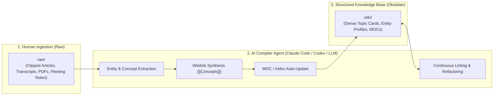

# Research Report: Andrej Karpathy's LLM Wiki Paradigm

> **"Compile, Don't Retrieve: Treating Knowledge Management as Software Compilation."**

---

## 1. Executive Summary & Genesis

In late 2023 and throughout 2024–2025, **Andrej Karpathy** (former Director of AI at Tesla and OpenAI founding member) introduced and popularized the **"LLM Wiki"** paradigm via his seminal GitHub Gist and public discussions.

Karpathy identified a fundamental flaw in contemporary RAG (Retrieval-Augmented Generation) systems:
> **Traditional RAG is like running an uncompiled, unindexed search query across gigabytes of raw, messy text on every user question.** It is slow, token-inefficient, and prone to hallucinations because it forces the LLM to synthesize fragmented chunks in real time.

Instead, Karpathy proposed **treating personal knowledge management (PKM) as a compiled codebase**:
1. **Raw Layer (`/raw`)**: A staging area for unfiltered human inputs (web clips, audio transcripts, PDFs, quick thoughts).
2. **AI Compiler**: An AI Agent acting as an active **Librarian / Compiler** that processes raw inputs ahead of time.
3. **Compiled Wiki Layer (`/wiki`)**: Dense, structured, highly interconnected Markdown pages (`[[Concepts]]`, `[[Entities]]`) and Maps of Content (MOCs).
4. **Instant Querying**: When the user asks a question, the Agent reads the pre-compiled, highly structured Wiki page in 10ms instead of searching 50 raw chunks.

---

## 2. Core Architectural Principles of the LLM Wiki

### Principle 1: Separation of Concerns (`/raw` vs `/wiki`)
* **`/raw` (Human Territory)**: Append-only, noisy, raw transcripts, web clippings. Never manually cleaned.
* **`/wiki` (AI Territory)**: High-density, structured, standardized Markdown pages maintained primarily by the AI agent.

### Principle 2: Pre-Compilation over Runtime Chunking
* Knowledge is synthesized *at ingestion time* or during *idle maintenance*, not during high-stakes conversational queries.
* Concepts compound: every new raw note updates existing entity pages rather than creating isolated duplicate notes.

### Principle 3: Markdown & Wikilinks as the Intermediate Representation (IR)
* Plain Markdown files with Obsidian-style `[[wikilinks]]` serve as an open, portable AST (Abstract Syntax Tree).
* No proprietary database lock-in; human and AI share the exact same readable representation.

### Principle 4: Codebase-Style Governance & Refactoring
* The knowledge base is governed like a software repository:
  - **Ingest** = Build step
  - **Lint** = Static analysis (detecting broken links, orphan notes, contradictory claims)
  - **Refactor** = Merging concepts and updating deprecated assumptions.

---

## 3. Community Landscape & Implementations

| Project | Approach / Stack | Strengths | Limitations |
| :--- | :--- | :--- | :--- |
| **`karpathy/llm-wiki`** | Original GitHub Gist specification | Defined the core manifesto and mental model | Conceptual gist, no packaged tooling |
| **`NicholasSpisak/second-brain`** | Agent Skills (`npx skills`) + Obsidian | Clean CLI workflow (`/ingest`, `/query`, `/lint`), agent-agnostic | Assumes a rigid `raw/` and `wiki/` structure; does not dynamically adapt to existing PARA vaults |
| **`green-dalii/obsidian-llm-wiki`** | Obsidian Plugin (TypeScript) | Direct UI integration inside Obsidian editor | Requires Electron desktop app; cannot run in headless CLI/Ductor environments |
| **`kytmanov/obsidian-llm-wiki-local`** | Local-First / Ollama | 100% offline privacy | Local model context limitations on large vault graphs |
| **`Ar9av/obsidian-wiki`** | `CLAUDE.md` + Agent prompt contract | Treats vault as a repo with prompt-driven CI | Lacks deterministic headless FTS5 indexer |

---

## 4. Key Takeaways for `KnowledgeRouter`

1. **Adopt the Compilation Concept**: Enhance `KnowledgeRouter` with a dedicated `compile` workflow that extracts entities from `000_Inbox/` and compiles them into `100_Project/` and `200_Area/`.
2. **Universal Compatibility**: Unlike other tools that force a strict `raw/` and `wiki/` folder structure, `KnowledgeRouter` automatically detects and adapts to existing PARA, Johnny Decimal, and Zettelkasten vaults.
3. **Headless FTS5 Engine**: Maintain our zero-dependency C-level SQLite FTS5 engine for sub-30ms retrieval across both raw notes and compiled wikis.
4. **MOC Automatic Maintenance**: Implement automatic cascading updates to Maps of Content (`Project_MOC.md`, `Area_MOC.md`) whenever new concepts are compiled.
