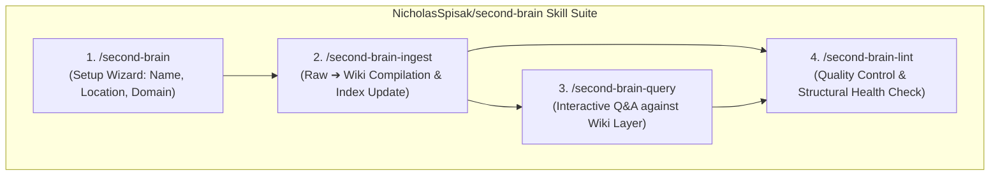

# Deep Dive: NicholasSpisak/second-brain Architecture Analysis

> **A Comprehensive Technical Evaluation of the "Second Brain" Agent Skill Package.**

---

## 1. Project Overview

* **Repository**: [`NicholasSpisak/second-brain`](https://github.com/NicholasSpisak/second-brain)
* **Tagline**: *"An LLM-maintained personal knowledge base built on the LLM Wiki pattern."*
* **Ecosystem**: Packaged as standard [Agent Skills](https://agentskills.io), installable across 40+ AI agents (Claude Code, Cursor, Codex CLI, Gemini CLI) via `npx skills add NicholasSpisak/second-brain`.

`NicholasSpisak/second-brain` is currently one of the most prominent open-source implementations of Andrej Karpathy's "LLM as Librarian" concept. It provides an automated, agent-driven workflow to convert raw human clips into a compiled Obsidian wiki.

---

## 2. Architecture & File Structure

The project mandates a two-tier folder structure within Obsidian:

```text
your-vault/
├── raw/                    # Human Ingestion Layer (Web Clipper, PDFs, Transcripts)
│   └── assets/             # Images and attachments
└── wiki/                   # AI-Maintained Knowledge Layer
    ├── index.md            # Master Topic Map & Table of Contents
    ├── concept_a.md        # Compiled concept & entity notes
    └── concept_b.md        # Cross-linked conceptual summaries
```

---

## 3. The Four Core Agent Skills



### 1. `/second-brain` (Setup Wizard)
* Guides the user through creating a fresh vault.
* Configures naming, directory paths, and tools like the [Obsidian Web Clipper](https://chromewebstore.google.com/detail/obsidian-web-clipper/cnjifjpddelmedmihgijeibhnjfabmlf) to dump content into `raw/`.

### 2. `/second-brain-ingest` (Compilation Engine)
* **Trigger**: Invoked after dropping new materials into `raw/`.
* **Action**:
  1. The LLM reads uncompiled raw sources.
  2. Extracts key takeaways, entities, and conceptual definitions.
  3. Creates or incrementally updates Markdown notes in `wiki/`.
  4. Injects bidirectional `[[wikilinks]]` and updates `wiki/index.md`.

### 3. `/second-brain-query` (Retrieval & Synthesis)
* Answers user questions by querying the structured `wiki/` layer.
* Emphasizes source attribution and navigating via the compiled knowledge graph.

### 4. `/second-brain-lint` (Knowledge Base Linter)
* **The standout capability of the project**. Acts as a code linter for Markdown:
  * 🔍 **Broken Wikilinks**: Detects `[[links]]` pointing to non-existent notes.
  * 🏝️ **Orphan Pages**: Identifies notes with zero inbound links.
  * ⚠️ **Contradictory Claims**: Flags conflicting statements across different sources.
  * ⏳ **Stale Content**: Identifies outdated concept definitions.
* **Recommended Schedule**: Run after every 10 ingests or once a month.

---

## 4. Strengths & High-Value Learnings (特长与可借鉴经验)

1. **Standardized Agent Skill Packaging**:
   - By leveraging the `agentskills.io` standard, it achieves zero-friction installation across multiple LLM CLI agents (`npx skills add`).
2. **Explicit Quality Control (`/lint`)**:
   - Treating vault consistency as a linting problem (finding orphans, broken links, contradictions) is a brilliant software engineering parallel.
3. **Structured Discussion during Ingestion**:
   - The ingest skill does not just silently write files; it discusses key takeaways with the user, ensuring alignment before committing to the wiki.

---

## 5. Limitations & Gaps (局限与不足)

1. **Rigid Folder Hierarchy**:
   - It strictly expects `raw/` and `wiki/`. It **cannot operate on existing real-world vaults** that use Johnny Decimal (`100_Project`, `200_Area`, `300_Resources`), PARA, or complex multi-project directories.
2. **Lack of a Standalone Headless FTS5 Engine**:
   - Retrieval relies purely on the agent reading files sequentially or full-context loading. On vaults with 1,500+ notes, this causes high token costs and latency.
3. **No 4D Multi-Intent Routing**:
   - Lacks distinction between project tasks (`TASKS.md`), daily meeting logs (`100_Logs/`), and domain knowledge (`200_Area/`). Everything is flattened into `wiki/`.
4. **No Decision Context Assembly**:
   - Focuses primarily on encyclopedia-style compilation rather than assembling multi-source decision briefings for active engineering execution.

---

## 6. How `KnowledgeRouter` Surpasses and Complements `second-brain`

| Dimension | `NicholasSpisak/second-brain` | `KnowledgeRouter` (Our Project) |
| :--- | :--- | :--- |
| **Vault Compatibility** | Only supports new, rigid `raw/` + `wiki/` vaults | **Universal Adaptation**: Automatically detects and adapts to PARA, Johnny Decimal, Zettelkasten, and existing 1,500+ note vaults |
| **Search Engine** | Agent file-reading / LLM context window | **Headless C-Level SQLite FTS5 Engine**: Sub-30ms lexical search + Bounded Excerpts (~800 chars) |
| **Routing Engine** | Binary (Raw vs Wiki) | **4D Cognitive Router**: Classifies Intent (Logs, Active Projects, Areas, Resources, Inbox buffer) |
| **Decision Support** | Basic Q&A query | **Context Assembler (`context_assembler.py`)**: Assembles structured `DECISION_BRIEF` for architecture/business decisions |
| **Linting & Health** | Interactive skill prompt | **Standalone Script (`vault_doctor.py`) + Skill Contract** for both headless CLI and conversational modes |

---

## 7. Actionable Roadmap Upgrades for `KnowledgeRouter`

1. **Absorb the Linting Paradigm**: Build `scripts/vault_doctor.py` into `KnowledgeRouter` to check for broken links, orphan notes, and stale project MOCs.
2. **Integrate Ingest/Compile Pipeline**: Implement `scripts/compiler.py` allowing users to run `python scripts/compiler.py --from 000_Inbox --into 200_Area`.
3. **Packaging Support**: Support both standalone Python CLI and `npx skills` / `codex skills` packaging standards.
